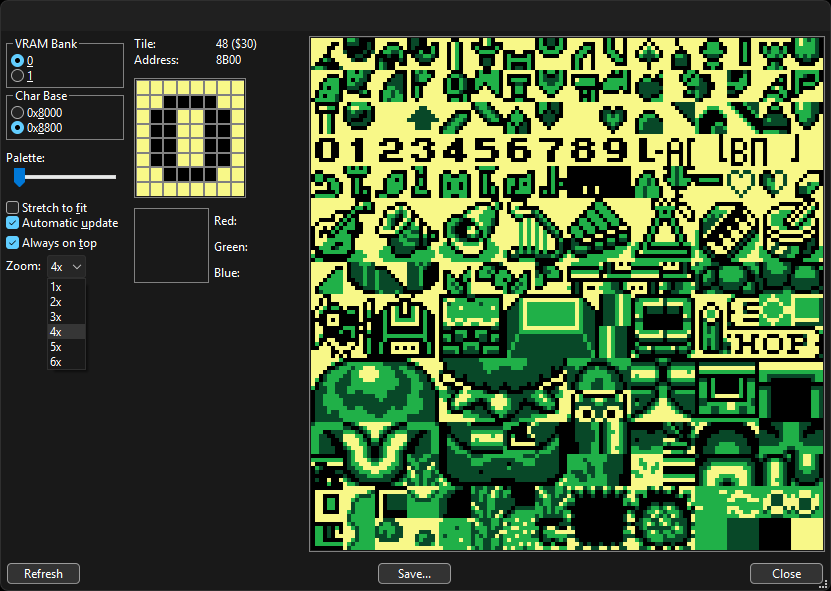

# VBA-M Tile Viewer Zoom

Adds **1× through 6× zoom** to the Tile Viewer Window. Open a game, choose **Tools → Tile Viewer**, and pick a zoom level. Selecting a zoom level turns off **Stretch**. Clear **Always on top** to let the tile viewer go behind the main window. Tile IDs display decimal and hexadecimal together now, for example `255 ($FF)`.



This is a standalone patch for [VisualBoyAdvance-M 2.2.3](https://github.com/visualboyadvance-m/visualboyadvance-m/releases/tag/v2.2.3), based on upstream commit `48ed03b02701b1cd72cbededeb07d9bc18bcee03`. It changes five wxWidgets source files and two dialog layouts.

## Clone and apply the patch

Clone the VBA-M 2.2.3 tag with its submodules.

```sh
git clone -c core.autocrlf=false --branch v2.2.3 --single-branch --recurse-submodules https://github.com/visualboyadvance-m/visualboyadvance-m.git
```

Copy `tile-viewer.patch` into the new `visualboyadvance-m` folder. For MSYS2, copy `msys2-static-lzma.patch` there too. Then run:

```sh
cd visualboyadvance-m
git apply --check tile-viewer.patch && git apply tile-viewer.patch
```

## Build for 64-bit Windows

Choose either MSYS2 UCRT64 with GCC or Visual Studio with MSVC. Start with the patched checkout from the steps above. Run CMake from the directory containing VBA-M's `CMakeLists.txt`. Each method uses its own build directory and builds a static Release configuration with FFmpeg recording and automatic updates disabled.

### MSYS2 UCRT64

Open **MSYS2 UCRT64** from the Start menu. If the update asks you to close the terminal, reopen UCRT64 and run `pacman -Syu` again.

```bash
pacman -Syu
pacman -S --needed git zip \
  mingw-w64-ucrt-x86_64-{gcc,cmake,ninja,pkgconf,gettext-tools,wxwidgets3.3-msw,SDL2,zlib,bzip2,xz}
wx-config --static=yes --version
```

Confirm that `wx-config` reports 3.3.x for Windows dark mode support. From the cloned source folder, apply the static liblzma fix.

```bash
git apply --check msys2-static-lzma.patch && git apply msys2-static-lzma.patch
```

Configure with SDL2, regenerate the tile-viewer layouts, and build.

```bash
cmake -S . -B build-ucrt64-wx33 -G Ninja \
  -DCMAKE_BUILD_TYPE=Release \
  -DVBAM_STATIC=ON \
  -DENABLE_SDL3=OFF \
  -DENABLE_FFMPEG=OFF \
  -DENABLE_ONLINEUPDATES=OFF \
  -DENABLE_LTO=OFF \
  -DBUILD_TESTING=OFF \
  -DLZMA_LIBRARY:FILEPATH="$(cygpath -m "$MINGW_PREFIX/lib/liblzma.a")" &&
cmake -E rm -f build-ucrt64-wx33/src/wx/wxvbam.xrs &&
cmake --build build-ucrt64-wx33 --target src/wx/wxvbam.xrs &&
cmake --build build-ucrt64-wx33
```

Run `build-ucrt64-wx33/visualboyadvance-m.exe`. To list its direct DLL imports, run:

```bash
objdump -p build-ucrt64-wx33/visualboyadvance-m.exe | grep 'DLL Name'
```

### Visual Studio 2022

Copy `tile-viewer.patch` into the cloned `visualboyadvance-m` folder, next to `CMakeLists.txt`. Apply it once from that folder.

```bat
git apply --check tile-viewer.patch && git apply tile-viewer.patch
```

If you already applied the tile viewer patch in the shared setup or for UCRT64, continue with the build below. `msys2-static-lzma.patch` is only for the MSYS2 build.

Install **Visual Studio 2022 Build Tools** or Visual Studio 2022 with **Desktop development with C++**, including the MSVC x64 tools, a Windows SDK, and **C++ CMake tools for Windows**. Open **x64 Native Tools Command Prompt for VS 2022** and change to the patched source directory.

Use the `x64-windows-static` vcpkg triplet from the [VBA-M 2.2.3 Visual Studio workflow](https://github.com/visualboyadvance-m/visualboyadvance-m/blob/v2.2.3/.github/workflows/visual-studio-build.yml). The first configure may take a while as vcpkg sets up dependencies.

```bat
cmake -S . -B build-msvc-x64 -G Ninja ^
  -DCMAKE_BUILD_TYPE=Release ^
  -DVCPKG_TARGET_TRIPLET=x64-windows-static ^
  -DENABLE_SDL3=ON ^
  -DENABLE_FFMPEG=OFF ^
  -DENABLE_ONLINEUPDATES=OFF ^
  -DBUILD_TESTING=OFF

cmake --build build-msvc-x64
```

Run `build-msvc-x64\visualboyadvance-m.exe`. To list its direct DLL imports, run:

```bat
dumpbin /dependents build-msvc-x64\visualboyadvance-m.exe
```

## Build for 32-bit Windows

VBA-M's [Visual Studio build workflow](https://github.com/visualboyadvance-m/visualboyadvance-m/blob/v2.2.3/.github/workflows/visual-studio-build.yml) uses the `x86-windows-static` vcpkg triplet. Install Visual Studio 2022 with **Desktop development with C++**, the x86 build tools, CMake, Ninja, and vcpkg. Open the **x86 Native Tools Command Prompt for VS 2022** and run these commands from the patched source directory.

```bat
cmake -S . -B build-x86 -G Ninja -DCMAKE_BUILD_TYPE=Release -DVCPKG_TARGET_TRIPLET=x86-windows-static -DBUILD_TESTING=OFF
cmake --build build-x86
```

For the MinGW route and other platforms, see the [VBA-M developer manual](https://github.com/visualboyadvance-m/visualboyadvance-m/blob/v2.2.3/DEVELOPER-MANUAL.md#32-bit-windows-binary) and [build instructions](https://github.com/visualboyadvance-m/visualboyadvance-m/blob/v2.2.3/README.md).

## License

The patch uses the GNU General Public License, version 2 or later, consistent with the upstream notice for the modified files. See [COPYING](COPYING) and [UPSTREAM-NOTICE.txt](UPSTREAM-NOTICE.txt). VisualBoyAdvance-M is developed by the VBA-M project.
